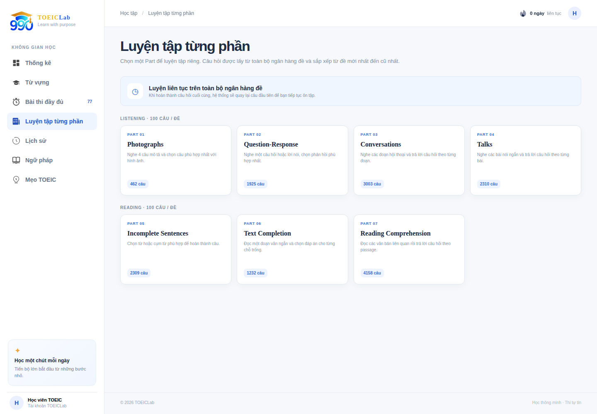

# TOEIC Lab

TOEIC Lab giúp bạn ôn từ vựng, luyện tập từng phần và làm bài thi thử trong cùng một nơi. Theo dõi kết quả sau mỗi lần học để biết phần nào cần luyện thêm.

Trải nghiệm ứng dụng: [toeiclab.io.vn](https://toeiclab.io.vn)



## Bạn có thể làm gì với TOEIC Lab?

- **Học từ vựng theo chủ đề:** tra cứu 600 từ thiết yếu cùng phiên âm IPA, nghĩa, ví dụ, hình ảnh và audio phát âm.
- **Tự kiểm tra từ vựng:** làm quiz theo phạm vi đã học, trả lời theo hai chiều Việt → Anh hoặc Anh → Việt, rồi xem lại câu trả lời.
- **Luyện từng Part:** luyện riêng một trong 7 Part TOEIC, không giới hạn thời gian và có thể kiểm tra đáp án ngay.
- **Thi thử đầy đủ:** chọn trong ngân hàng 77 đề, làm bài theo thời lượng 120 phút, lưu câu trả lời trong lúc thi và xem điểm theo từng Part sau khi nộp.
- **Xem lại và cải thiện:** xem lịch sử bài làm, bài chữa và transcript; theo dõi tiến độ luyện tập, độ chính xác và điểm TOEIC ước tính trên trang thống kê.
- **Ôn kiến thức:** đọc tài liệu ngữ pháp và mẹo làm bài TOEIC.

Bạn có thể xem nội dung học và danh sách đề thi khi chưa đăng nhập. Đăng nhập hoặc tạo tài khoản để lưu bài làm và đồng bộ tiến độ học tập.

## Bắt đầu học

1. Mở trang **Từ vựng** để chọn chủ đề hoặc thử quiz.
2. Vào **Bài thi đầy đủ** để chọn đề thi thử, hoặc **Luyện tập từng phần** để tập trung vào một kỹ năng.
3. Đăng nhập để lưu kết quả, xem lịch sử và theo dõi tiến độ trên trang thống kê.

Các mục **Ngữ pháp** và **Mẹo TOEIC** cung cấp tài liệu tham khảo trong lúc ôn tập.

## Triển khai ứng dụng

### Chạy local bằng Docker Compose

Bạn cần Docker Engine hoặc Docker Desktop đang chạy. Thực hiện các lệnh sau từ thư mục `toeiclab`:

1. Tạo file cấu hình local:

   ```bash
   cp .env.example .env
   ```

2. Khởi động các dịch vụ:

   ```bash
   docker compose -f docker/docker-compose.dev.yml up --build
   ```

3. Mở [http://localhost](http://localhost).

Compose chạy frontend, Django API, MySQL, Redis và Nginx. Khi volume MySQL được tạo lần đầu, MySQL tự tạo schema và nạp dữ liệu từ `mysql/init/*.sql`. Xem thứ tự các file nạp tại [mysql/README.md](mysql/README.md).

### Chạy frontend và backend riêng

Cách này phù hợp để xem giao diện hoặc phát triển frontend. Frontend chạy bằng Node.js, backend dùng SQLite mặc định.

Trong terminal thứ nhất:

```bash
cd frontend
npm install
HOST=0.0.0.0 PORT=3000 API_PROXY_TARGET=http://localhost:8000 npm start
```

Trong terminal thứ hai:

```bash
cd backend
python -m venv .venv
source .venv/bin/activate
pip install -r requirements.txt
python manage.py migrate --run-syncdb
DJANGO_DEBUG=true python manage.py runserver 0.0.0.0:8000
```

Mở [http://localhost:3000](http://localhost:3000). SQLite mặc định không được nạp bộ dữ liệu MySQL; để xem đầy đủ từ vựng và đề thi, hãy chạy toàn bộ Compose.

### Kiến trúc và cấu hình

- **Frontend:** React, React Router và SCSS; các màn hình gọi API qua `frontend/src/services`.
- **Backend:** Django REST Framework, tổ chức theo các domain `users`, `content`, `vocabulary`, `learning`, `assessments` và `knowledge`.
- **Dữ liệu:** MySQL quản lý schema và nội dung qua các script SQL trong `mysql/init`.
- **Hạ tầng:** Docker Compose chạy Redis cho cache và Nginx làm reverse proxy. Nginx chuyển `/` tới frontend, `/api/` và `/admin/` tới Django.

Trong môi trường development, Nginx dùng cổng `80`, MySQL mở cổng host `3307` và Redis mở cổng `6380`. Frontend và Django chỉ truy cập qua mạng nội bộ Docker. Khi `DJANGO_DEBUG=true`, mã OTP được trả về trong response và in ra console email backend.

### Triển khai production

Điền secret mạnh và domain phù hợp trong `.env`, sau đó chạy:

```bash
docker compose --env-file .env -f docker/docker-compose.prod.yml up --build -d
```

Chỉ Nginx publish cổng HTTP; MySQL và Redis ở mạng nội bộ. Cấu hình SMTP để gửi OTP thật. Google Sign-In hoạt động khi `GOOGLE_CLIENT_ID` được cấu hình cho backend và lúc build frontend. Nên đặt TLS ở reverse proxy hoặc load balancer trước khi mở ứng dụng ra Internet.

Tạo tài khoản quản trị Django:

```bash
docker compose --env-file .env -f docker/docker-compose.prod.yml exec backend python manage.py createsuperuser
```

Admin ở `/admin/`. API docs ở `/api/docs/` (Swagger), `/api/redoc/` (ReDoc), schema tại `/api/schema/` và health check tại `/api/v1/health/`.

### Kiểm tra ứng dụng

```bash
cd backend
python manage.py check
python manage.py test
cd ../frontend
npm ci
npm run build
```
